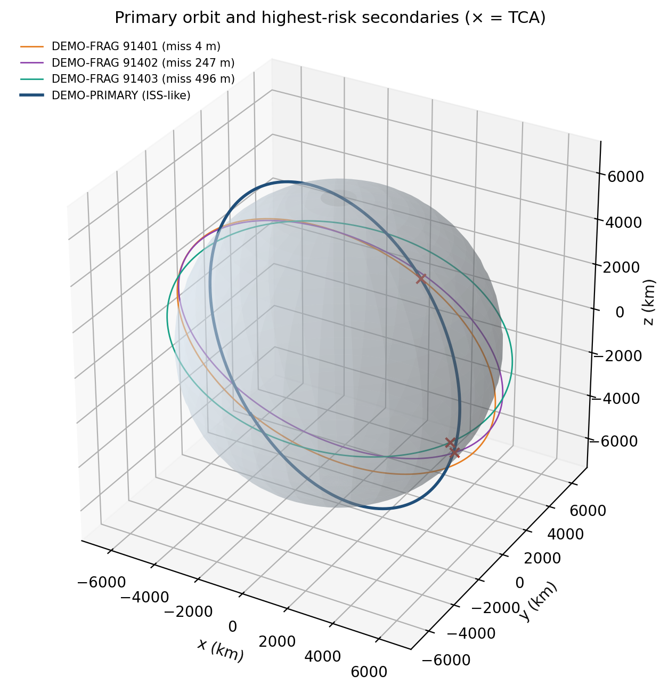
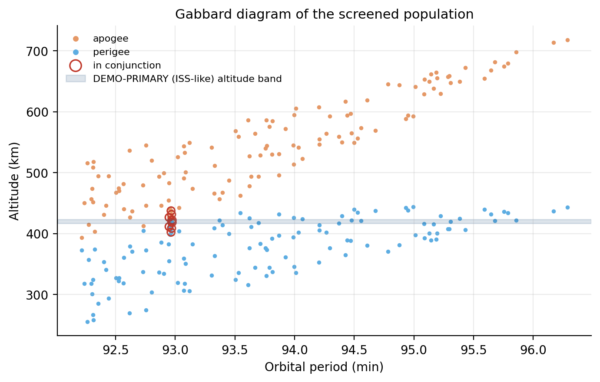
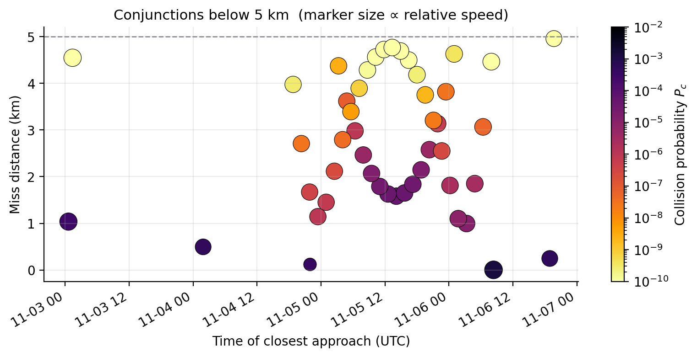
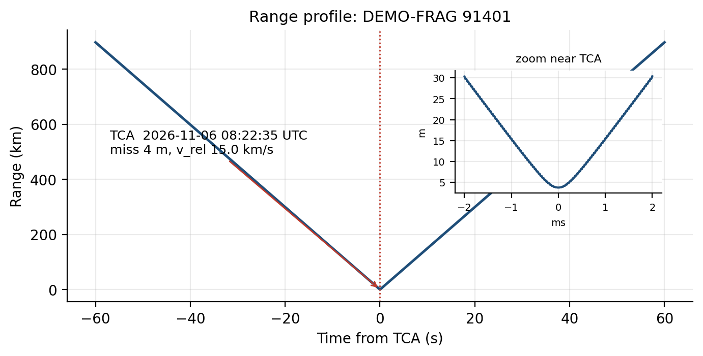
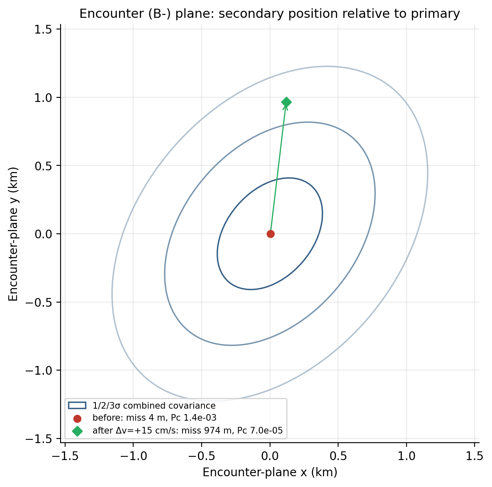
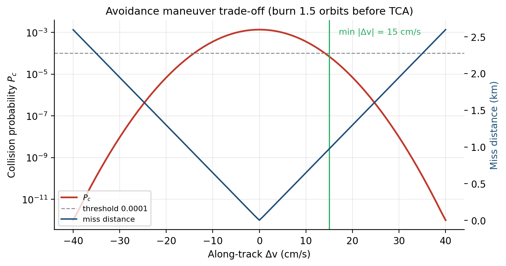

# LEO Conjunction Screening & Collision-Avoidance Planning

A compact Python pipeline that screens a satellite in Low Earth Orbit against debris
populations, estimates the probability of collision for each close approach, and designs
the smallest along-track maneuver that brings the risk below an operational threshold.

```
CelesTrak TLEs ─► SGP4 propagation ─► conjunction screening ─► Pc (Foster 2D) ─► Δv planning (J2 + CW)
```

## What it does

| Step | Method |
|---|---|
| **Catalog** | Downloads TLEs from CelesTrak (protected satellite by NORAD ID; debris by group, e.g. Cosmos 2251, Iridium 33, Fengyun-1C fragments) and caches them locally. |
| **Pre-filter** | Drops objects whose perigee/apogee band never overlaps the primary's. |
| **Propagation** | Vectorised SGP4 (`sgp4.SatrecArray`) on a 30 s grid over the screening window. |
| **Screening** | Local minima of range, refined with a bounded Brent search to find the time of closest approach (TCA) and miss distance. |
| **Collision probability** | Encounter (B-) plane projection of the combined position covariance; 2D Gaussian integrated over the hard-body circle (Foster method). |
| **Avoidance maneuver** | Along-track impulse applied *k* orbits before TCA. Its effect is computed with a numerical two-body + J2 propagator as a differential correction to the SGP4 ephemeris; a Clohessy-Wiltshire closed form is reported as a cross-check. The planner searches for the minimum \|Δv\| that brings Pc below the target (default 10⁻⁴). |

## Example results (real data)

NOAA 19 (~850 km, inside the Fengyun-1C debris shell) screened against the Cosmos 2251, Iridium 33,
and Fengyun-1C debris catalogs (2,673 objects) for 7 days from 2026-10-30: 1,714 objects share its
altitude band and **8 conjunctions** fall under 5 km. The closest-risk event (2.3 km miss at
12.7 km/s, Pc ≈ 9 × 10⁻⁶) is below the 10⁻⁴ action threshold, so no maneuver is required, which is
the typical outcome for real screening. The ISS (~420 km) sees no approaches under 5 km from these
clouds in the same window (closest ≈ 6.6 km).

## Example results (synthetic demo scenario)

ISS-like primary (≈420 km, 51.6°) against a 406-object synthetic fragment cloud, 7-day window:

- 121 objects overlap the primary's altitude band; **47 conjunctions** under 5 km.
- Highest-risk event: miss distance **4 m** at **15.0 km/s**, Pc ≈ **1.4 × 10⁻³**.
- Minimum avoidance burn: **+15 cm/s** along-track, 1.5 orbits before TCA → miss ≈ 970 m, Pc ≈ **7 × 10⁻⁵**.
- The Clohessy-Wiltshire estimate gives a ≈3.8 km along-track shift for that burn; only part of it
  appears in the encounter plane because the along-track direction is partly aligned with the
  relative velocity, which is why burn direction and timing matter as much as magnitude.

| | |
|---|---|
|  |  |
|  |  |
|  |  |

## GUI

An interactive Streamlit app (`app.py`) wraps the whole pipeline: pick a protected satellite and
debris populations, set the window and thresholds, browse every conjunction in a sortable table,
and select any event to plan its avoidance burn.

```bash
./start_gui.command        # macOS: double-click works too; first run installs packages
# or: streamlit run app.py
```

## Run it

```bash
python -m venv .venv && source .venv/bin/activate
pip install -r requirements.txt

# Real data (internet required): ISS vs. three major debris clouds, next 7 days
python run_analysis.py --primary 25544 --groups cosmos-2251-debris iridium-33-debris fengyun-1c-debris

# Offline demo with the synthetic fragment cloud
python run_analysis.py --demo
```

Useful options: `--days`, `--threshold-km`, `--pc-target`, `--lead-orbits`, `--start YYYY-MM-DD`.
Outputs go to `outputs/`: six figures, `conjunctions.csv`, and `summary.md`.

## Tests

```bash
pip install pytest
pytest -q
```

16 offline tests cover TLE parsing and caching, screening (all seeded crossers found, TCA is a true
range minimum), the Foster Pc against the closed-form isotropic solution, the maneuver planner
(zero-Δv consistency, target met, no burn when already safe, Clohessy-Wiltshire drift direction),
and GUI smoke tests via Streamlit's `AppTest`. They run on every push via GitHub Actions.

## Project layout

```
leoca/
  objects.py      catalog loading (CelesTrak) and synthetic demo cloud
  screening.py    SGP4 propagation, pre-filter, TCA refinement
  probability.py  RTN covariances, encounter plane, Foster Pc
  maneuver.py     J2 numerical propagation, CW check, minimum-Δv search
  visualize.py    figures
run_analysis.py   command-line entry point
app.py            Streamlit GUI
start_gui.command one-click launcher (macOS)
tests/            pytest suite (physics + GUI)
```

## Limitations (deliberate, for a first version)

- **No real covariance.** TLEs do not carry uncertainty, so position errors are *assumed*
  (RTN 1σ: primary 0.1/0.6/0.1 km, debris 0.3/1.5/0.3 km). Pc values are illustrative,
  not operational. Operational screening uses CDMs from the 18th Space Defense Squadron.
- **TLE accuracy** is on the order of a kilometre and degrades over days, comparable to the
  miss distances of interest.
- **Maneuver model** is a single impulsive along-track burn; it ignores drag changes after the burn
  and does not check for new conjunctions created by the maneuver.
- **Demo data are synthetic.** The demo seeds a few fragments to cross the primary's path so the
  full pipeline can be exercised offline; real runs use CelesTrak data.

## Next steps

- Use Space-Track CDMs (with covariance) instead of assumed uncertainties.
- Optimise burn direction (radial/along-track/cross-track) and timing, not just magnitude.
- Re-screen after the maneuver to catch secondary conjunctions.
- Train a reinforcement-learning agent in the Clohessy-Wiltshire frame to choose maneuvers under
  uncertain, perturbed tracking data.

## References

- Vallado, D. A., *Fundamentals of Astrodynamics and Applications*, 4th ed. (SGP4, relative motion)
- Foster, J. L., & Estes, H. S. (1992). *A parametric analysis of orbital debris collision probability and maneuver rate for space vehicles.* NASA JSC-25898.
- Alfano, S. (2005). Relating position uncertainty to maximum conjunction probability. *Journal of the Astronautical Sciences*, 53(2).
- NASA (2020). *Spacecraft Conjunction Assessment and Collision Avoidance Best Practices Handbook*.
